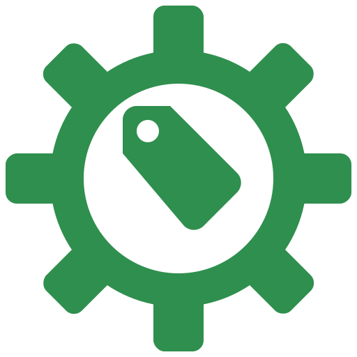

# Contributing

<b>English</b> · <a href="i18n/CONTRIBUTING.de.md">Deutsch</a>
<br /><br />

Thanks for taking the time. kassist is a small tool for one private account; a change that keeps it
small and careful with the account is usually the better change. Questions or larger ideas: open an
issue first, or write to kleinanzeigen-assistant-github@ollornog.de.

## Ground rules

1. **Be gentle with the account.** No headless browser, no captcha solving, no bursts of actions.
   Anything that makes kassist look less like a person using the site needs a very good reason.
2. **Tests belong to the change.** If you change behaviour, change a test in the same commit.
   Documentation (both READMEs) and `CHANGELOG.md` move with it.
3. **The suite stays offline and repeatable.** Tests never start Chrome, never reach Kleinanzeigen or
   an AI provider and never read the real `~/.config/kassist`. Run `./scripts/check.sh` twice; both
   runs must be green.
4. **No personal data in the repository.** No real names, addresses, postcodes, account data or
   message contents, not in code, sample data, tests, docs or commit messages. Use neutral examples
   (`10115 Berlin`, seller `alex`). `tests/test_repo.py` checks for private infrastructure and secrets.
5. **The look belongs to C22.** `src/kassist/gui/static/c22` is a vendored copy; change it upstream and
   re-run `scripts/vendor-c22.sh`.

## Workflow

Work on a feature branch. CI does not run there, `./scripts/check.sh` is your safety net. Open a pull
request; CI runs on the PR and on `main`.

```bash
git switch -c my-change
git config core.hooksPath .githooks    # once per clone: the pre-push hook runs the suite
# ... edit, then:
./scripts/check.sh
git commit -am "Describe the change, not the diff"
git push -u origin my-change
```

## Style

- Code, identifiers, comments, log and error messages are English; the GUI is English with a German
  translation (`src/kassist/gui/i18n.py`).
- Comments explain **why**, not what the next line does.
- Files are UTF-8 without BOM.
- No new dependency without a reason that fits in one sentence. `kleinanzeigen-bot` stays pinned by
  commit; raise the pin only after reading the upstream diff.

## Reporting bugs

Include what you expected, what happened, the kassist version (`CHANGELOG.md`) and the smallest
reproduction. Leave out personal data: no account names, no buyer messages, no addresses.

<br /><br />
<p align="right"></p>
